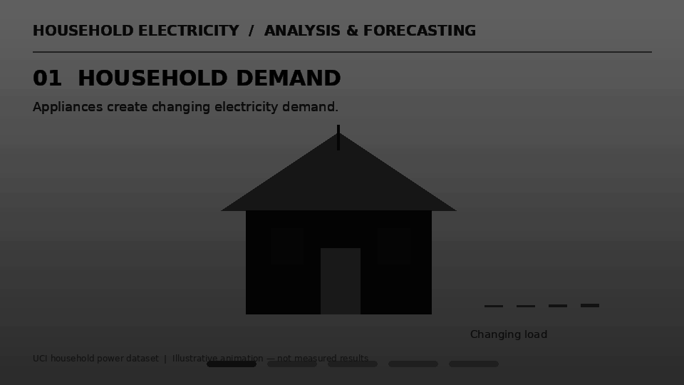
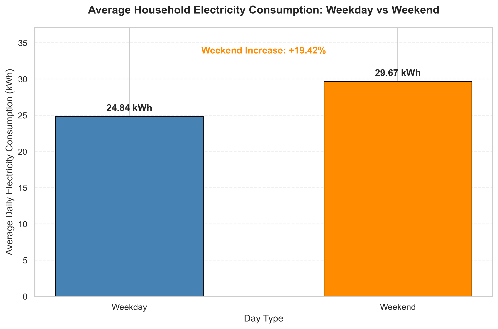
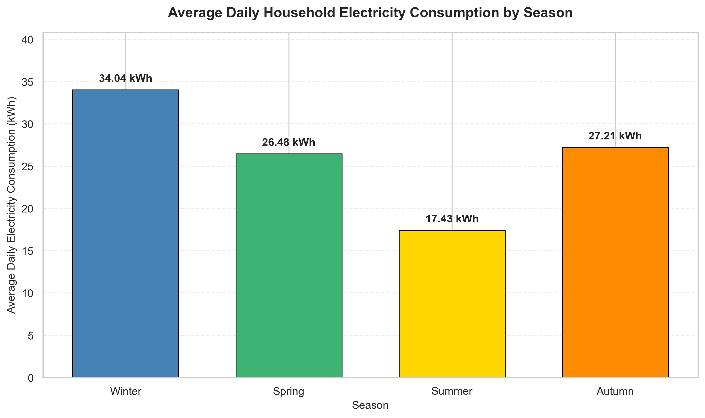
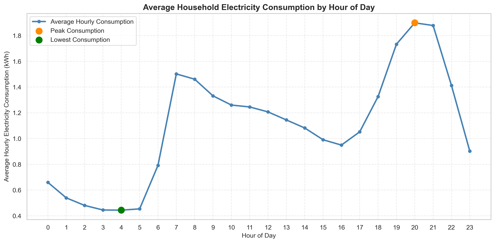
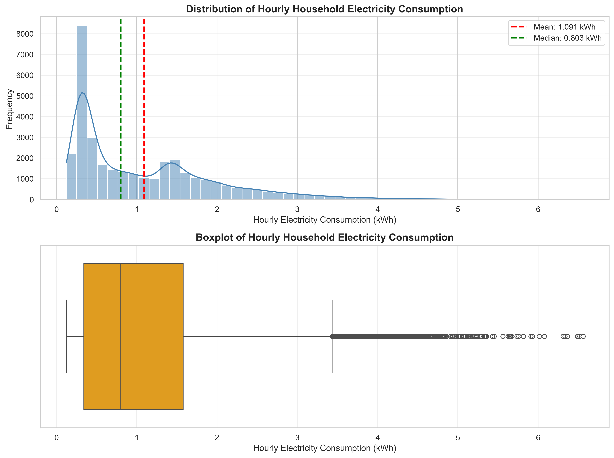
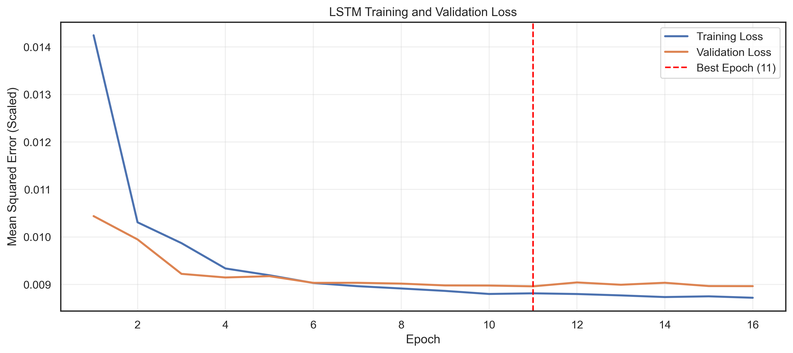
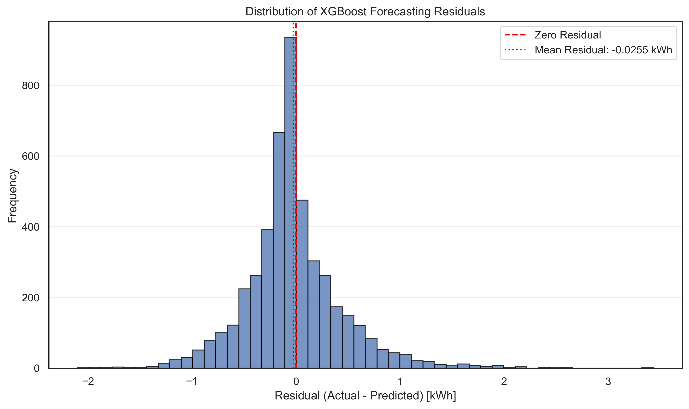
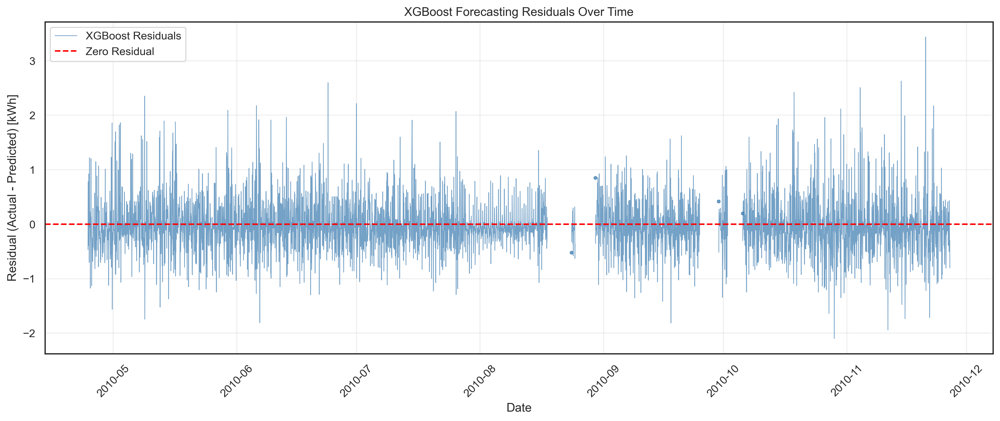

# Household Electricity Consumption Analysis and Forecasting

An end-to-end Python project investigating household electricity consumption patterns and forecasting hourly electricity demand using statistical, machine learning, and deep learning approaches.

The project covers data quality assessment, time-series preprocessing, exploratory data analysis (EDA), feature engineering, chronological model evaluation, and forecasting error diagnostics. **XGBoost Regression** was selected as the preferred forecasting model based on a common-timestamp validation comparison of five approaches.

## Animated project workflow

The animation summarizes the main stages of the analysis, from raw household electricity measurements through preprocessing, exploratory analysis, feature engineering, model comparison, and final evaluation.



*If the animation does not play in a Markdown preview, open the GIF directly in the `figure/` folder.*

## Project objectives

- Assess data quality, missing measurements, and timestamp continuity.
- Analyze hourly, daily, weekly, monthly, and seasonal electricity consumption patterns.
- Examine differences between weekdays and weekends and identify unusually high-demand periods.
- Build and compare five approaches to forecasting hourly household electricity consumption.
- Evaluate the selected model on previously unseen observations and investigate its forecasting errors.

## Dataset

**Source:** [UCI Machine Learning Repository — Individual Household Electric Power Consumption](https://archive.ics.uci.edu/dataset/235/individual+household+electric+power+consumption)

The dataset contains measurements from one household recorded between **December 2006 and November 2010**. The original measurements are provided at approximately one-minute resolution. The notebook processes these observations into an hourly electricity consumption series, expressed in **kWh**, for forecasting.

The source data include electrical measurements such as global active power, global reactive power, voltage, current intensity, and sub-metering values. Missing observations and gaps in the time series are explicitly assessed.

**Data availability:** The raw dataset is not included in this repository. Download `household_power_consumption.txt` from the UCI source and place it in the local `data/` directory before running the notebook.

## Technologies Used

- Python
- Jupyter Notebook
- Pandas and NumPy
- Matplotlib and Seaborn
- Scikit-learn
- XGBoost
- TensorFlow / Keras
- Git and GitHub

## Analysis workflow

1. **Data loading and inspection:** Inspect columns, data types, missing values, and timestamp consistency.
2. **Cleaning and preprocessing:** Apply limited interpolation to short missing-value gaps, construct a time index, and aggregate consumption into hourly energy values.
3. **Exploratory analysis:** Investigate consumption patterns by hour, day of week, weekday/weekend, month, and season; examine variability, correlations, and high-demand observations.
4. **Forecast preparation:** Construct lagged consumption and calendar-based features, then split observations chronologically into training, validation, and testing periods.
5. **Model comparison:** Evaluate five forecasting approaches using MAE, RMSE, and R² on aligned validation timestamps.
6. **Final testing and diagnostics:** Evaluate the validation-selected XGBoost model on unseen test observations and inspect residual distributions, temporal errors, and large forecasting deviations.

## Exploratory analysis visualizations

The following plots illustrate the household's temporal demand patterns. They are generated by the notebook and should be present in the repository's `figure/` directory for GitHub to display them.

### Weekday versus weekend electricity consumption



Average daily consumption is approximately **24.84 kWh on weekdays** versus **29.67 kWh on weekends** (about **19.42% higher** on weekends).

### Seasonal electricity consumption



The highest mean daily consumption occurs in winter (**34.04 kWh**) and the lowest in summer (**17.43 kWh**).

### Hourly consumption profile



The hourly profile helps identify changes in electricity demand across the day.

### Electricity consumption distribution



The distribution illustrates variation in demand, including relatively uncommon high-consumption events.

## Forecasting models

- **Persistence baseline:** Uses the previous hour's consumption as the forecast.
- **Linear Regression:** Models relationships between consumption and engineered predictors.
- **Random Forest Regression:** Uses an ensemble of decision trees to capture nonlinear patterns.
- **XGBoost Regression:** Uses gradient-boosted decision trees for nonlinear forecasting.
- **Long Short-Term Memory (LSTM):** Uses a recurrent neural network to learn from consumption sequences.

## Results

### Validation comparison

All five approaches were compared using **4,842 common validation observations**, aligned by timestamp and actual consumption value.

| Rank | Model | MAE (kWh) | RMSE (kWh) | R² |
|---:|---|---:|---:|---:|
| 1 | **XGBoost Regression** | **0.3730** | **0.5371** | **0.6316** |
| 2 | Random Forest Regression | 0.3775 | 0.5481 | 0.6163 |
| 3 | Linear Regression | 0.4176 | 0.5889 | 0.5572 |
| 4 | LSTM | 0.4326 | 0.6093 | 0.5259 |
| 5 | Persistence baseline | 0.4612 | 0.6868 | 0.3976 |

XGBoost achieved the lowest validation MAE and RMSE and the highest R². Its advantage over Random Forest was relatively small and should not be interpreted as proof of statistically significant superiority.

### Final unseen testing performance

The selected XGBoost model was evaluated on **4,721 previously unseen hourly observations**, covering **24 April 2010, 16:00 to 26 November 2010, 20:00**.

| Metric | XGBoost test result |
|---|---:|
| MAE | **0.3265 kWh** |
| RMSE | **0.4679 kWh** |
| R² | **0.5633** |

The testing R² indicates that XGBoost accounted for approximately 56.33% of the observed variation in hourly consumption during this period. Residual diagnostics showed generally small errors for many observations, alongside occasional substantial underpredictions during high-demand events.

### Forecasting diagnostics

#### LSTM training and validation loss



This figure shows the evolution of training and validation loss during LSTM fitting.

#### XGBoost residual distribution



The residual distribution provides insight into the magnitude, direction, and asymmetry of the selected model's forecasting errors.

#### XGBoost residuals over time



This figure illustrates how forecasting errors varied throughout the unseen testing period.

## Selected exploratory findings

- Average daily consumption was approximately **24.84 kWh on weekdays** and **29.67 kWh on weekends**, a **19.42% increase** on weekends.
- Seasonal average daily consumption was highest in **winter (34.04 kWh)** and lowest in **summer (17.43 kWh)**.
- Consumption varied considerably by hour and across days and seasons, with occasional unusually high-demand observations.

These findings describe the single household in the source dataset; they should not be assumed to represent all households.

## Repository structure

```text
Household_Electricity_Consumption_Analysis_and_Forecasting/
├── README.md
├── notebook/
│   └── Household_Electricity_Consumption_Analysis_and_Forecasting.ipynb
├── figure/
│   ├── household_electricity_project_workflow.gif
│   ├── weekday_vs_weekend_consumption.png
│   ├── seasonal_electricity_consumption.png
│   ├── hourly_consumption_profile.png
│   ├── hourly_consumption_distribution.png
│   ├── lstm_training_validation_loss.png
│   ├── xgboost_residual_distribution.png
│   └── xgboost_residuals_over_time.png
└── data/                  # Create locally; raw data are not tracked in Git
    └── household_power_consumption.txt
```

The `figure/` directory contains the workflow animation and generated plots. **All image files referenced above must be committed to GitHub for the README previews to render.** The notebook may generate additional figures beyond those listed here.

## How to run

1. Clone the repository:

   ```bash
   git clone https://github.com/damisar/Household_Electricity_Consumption_Analysis_and_Forecasting.git
   cd Household_Electricity_Consumption_Analysis_and_Forecasting
   ```

2. Create a Python environment and install the notebook's main dependencies:

   ```bash
   python -m pip install jupyter pandas numpy matplotlib seaborn scikit-learn xgboost tensorflow
   ```

3. Download the UCI dataset and save the extracted `household_power_consumption.txt` file inside a `data/` folder at the repository root.
4. Ensure a `figure/` directory exists at the repository root.
5. Start Jupyter from the repository root:

   ```bash
   jupyter notebook
   ```

6. Open `notebook/Household_Electricity_Consumption_Analysis_and_Forecasting.ipynb` and run the cells in order.

**Path note:** The notebook determines the project root using the parent of its current working directory. It is therefore intended to be executed with the working directory set to the repository's `notebook/` folder, as in the project layout above. If running from a different working directory, update the project directory configuration in Section 2.2.

**Reproducibility note:** Model training, particularly the LSTM, may take time. Results may vary slightly across environments or repeated training runs unless all relevant random seeds and deterministic execution settings are controlled.

## Limitations and future work

- **Single-household scope:** Results may not generalize to households with different usage patterns.
- **Missing time periods:** Data gaps remain relevant to time-series continuity; the final testing series included four intervals longer than one hour, with the longest lasting six days and two hours.
- **Limited predictors:** Weather, occupancy, and appliance operating conditions were not included.
- **High-demand events:** Sudden consumption increases remain difficult to forecast accurately.
- **Further evaluation:** Future work could include richer lag and rolling features, hyperparameter optimization, residual autocorrelation checks, walk-forward validation, and evaluation on additional households.

## Project conclusion

Historical consumption and calendar-based features provide useful information for forecasting household electricity demand. Among the five approaches evaluated on common validation timestamps, **XGBoost Regression** performed best and retained useful predictive capability on the unseen testing period. Forecasting exceptional demand spikes and assessing generalization beyond this household remain important directions for improvement.

## Data attribution

UCI Machine Learning Repository, *Individual Household Electric Power Consumption* dataset. Refer to the [dataset page](https://archive.ics.uci.edu/dataset/235/individual+household+electric+power+consumption) for source details and citation information.
